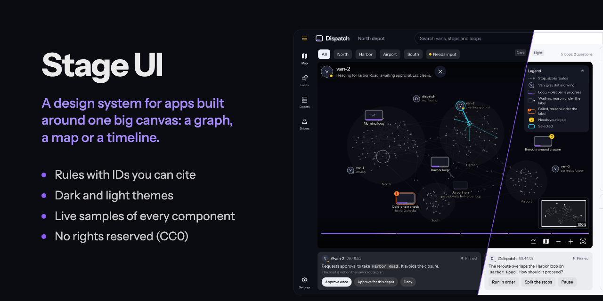
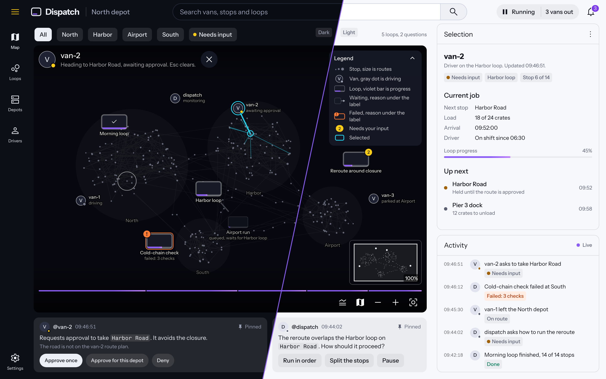
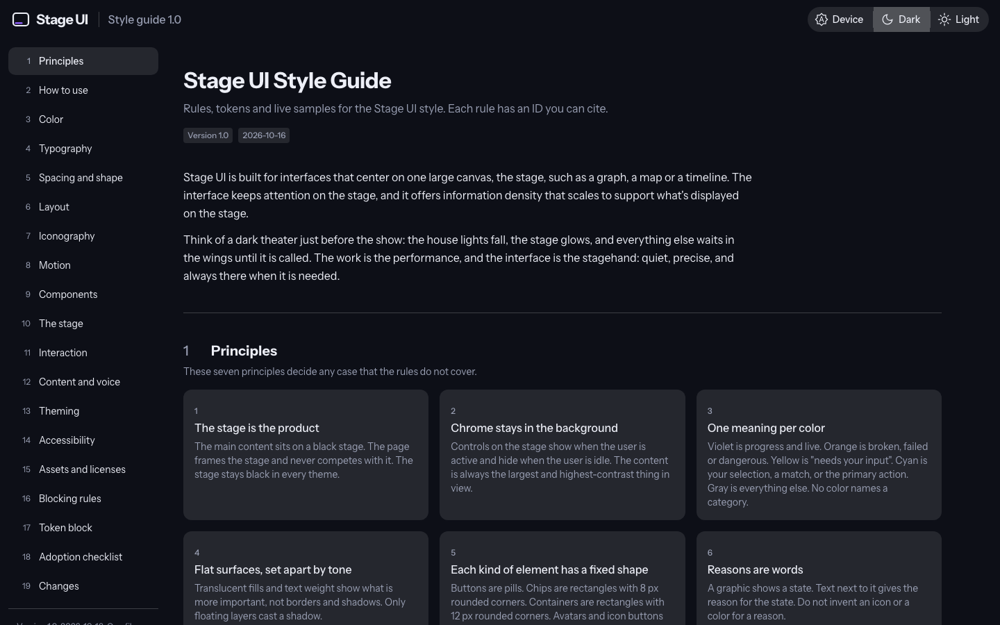
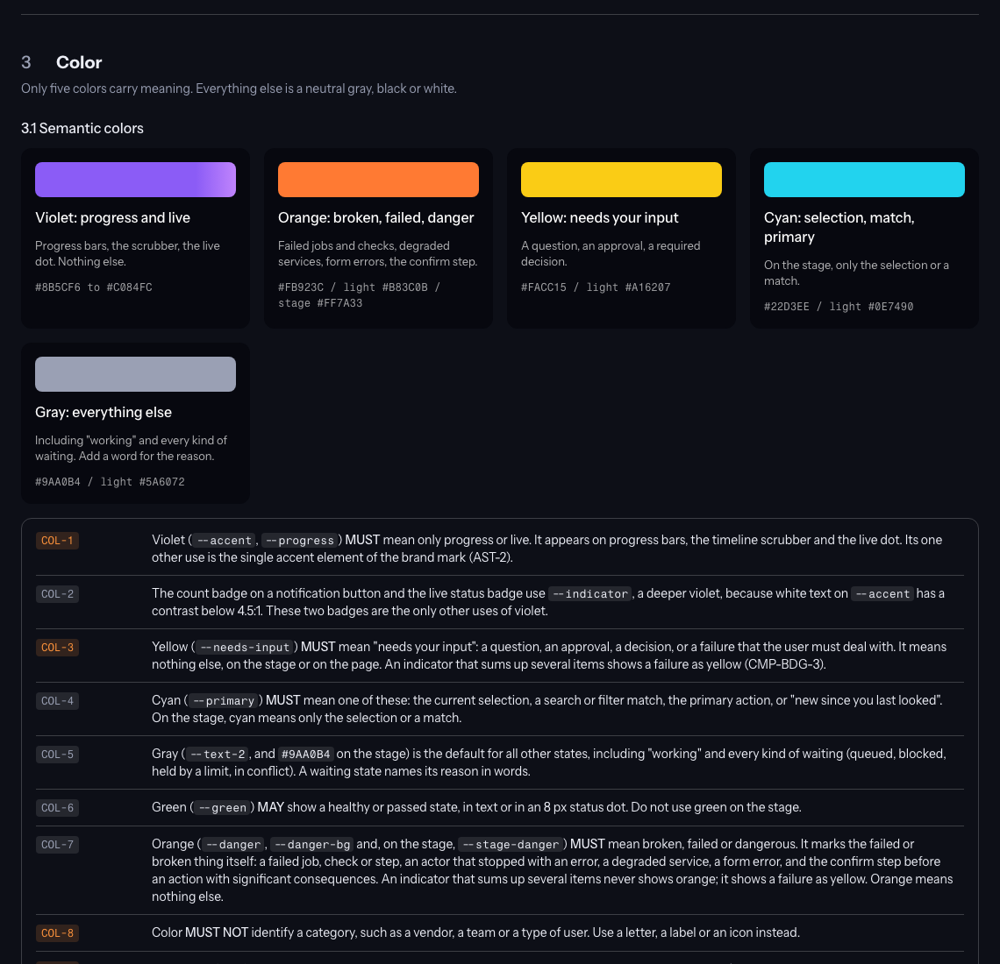
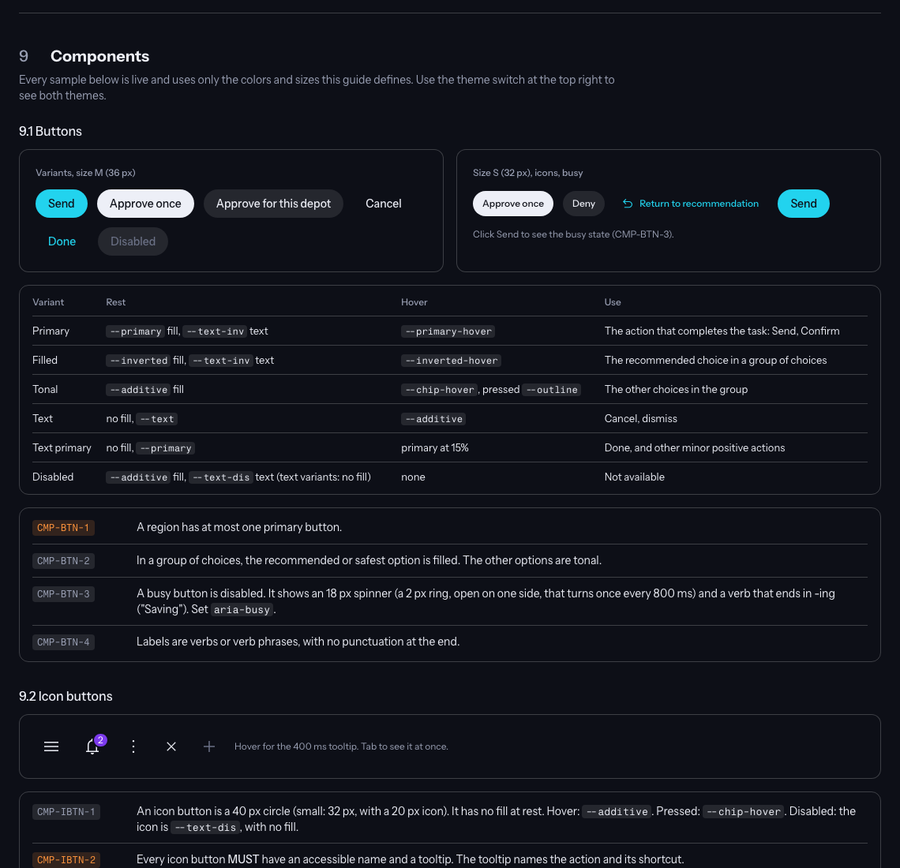
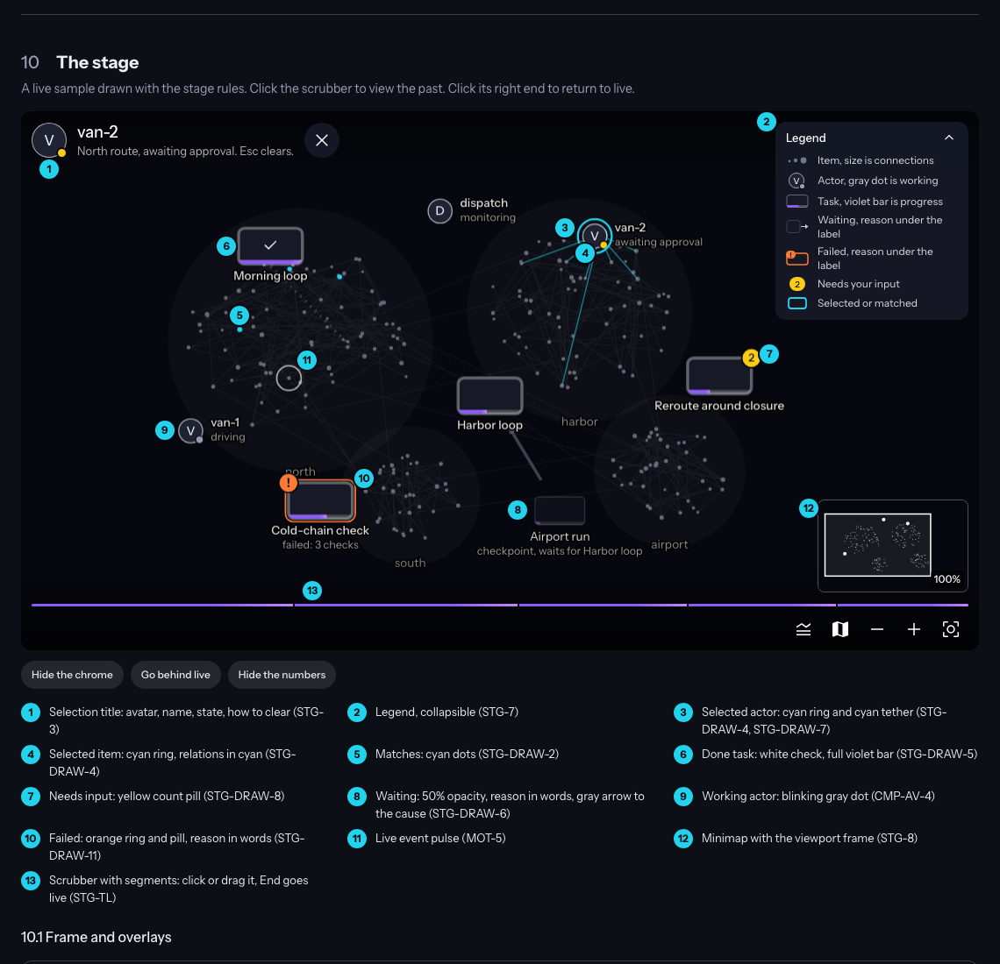

# Stage UI

**A design system for apps built around one big canvas.**

Some apps are mostly one large view: a graph, a map, a timeline, a media view. Stage UI is a style guide for that kind of app. It calls the big view **the stage**, and its rules keep your attention there. Everything else (menus, panels, buttons) stays quiet until you need it.

Think of a dark theater just before the show: the house lights fall, the stage glows, and everything else waits in the wings until it is called.



The same screen in both themes, split along a slanted line through the center. The map on the stage is the focus. The top bar, the side rail and the panels stay quiet around it.

## What you get

- **[`STYLE_GUIDE.html`](STYLE_GUIDE.html):** the guide as one web page. Download it and open it in any browser. Every rule is there, with live samples of each component, both themes, and a working sample of the stage. It needs no internet connection.
- **[`STYLE_GUIDE.md`](STYLE_GUIDE.md):** the same guide as plain text, for reading on GitHub, searching, and pasting into a project.
- **[`examples/dispatch.html`](examples/dispatch.html):** a sample app screen, "Dispatch", built only from the guide's tokens and components. Open it in any browser. Add `?theme=light` to the address for the light theme.
- **[`src/`](src/):** the files that build the web page from the text, with the fonts and icons it uses.

## Use it in your project

1. Copy `STYLE_GUIDE.md` and `STYLE_GUIDE.html` into your project, for example into `docs/`.
2. Paste the token block from section 17 into your stylesheet. It holds every color, size and timing, for both themes.
3. Build with the rules. Each rule has an ID, such as `COL-3`, so you can name it in a review or a commit.
4. Before a release, check the blocking rules in section 16. These are the rules that must never break.
5. Section 18 is a checklist for adopting the guide in an existing app.

The guide is written to be used as is: it depends on no project and no framework.

## The seven principles

These decide any case the rules do not cover.

1. **The stage is the product.** The main content sits on a black stage, in every theme. The rest of the page frames it and never competes with it.
2. **Chrome stays in the background.** Chrome is the controls on the stage. They show while you work and hide when you stop. The content is always the largest and highest-contrast thing in view.
3. **One meaning per color.** Violet is progress and "live". Orange is broken, failed or dangerous. Yellow is "needs your input". Cyan is your selection, a match, or the main action. Gray is everything else.
4. **Flat surfaces, set apart by tone.** Shades of fill and text weight show what matters, not borders and shadows. Only floating layers, such as menus, cast a shadow.
5. **Each kind of element has a fixed shape.** Buttons are pills. Chips have 8 px corners. Containers have 12 px corners. Avatars and icon buttons are circles.
6. **Reasons are words.** A graphic shows a state, and text next to it says why.
7. **Reduced modes are visible, and actions can be undone.** A badge says when the app runs with reduced function. A big action asks first, and a finished one offers Undo.

## A look inside

### The guide

The opening page of `STYLE_GUIDE.html`, in the dark theme.



### Color

Five colors, each with one meaning, plus an optional green for a healthy or passed state, in a dark and a light theme. The guide lists every token with its value and the contrast it was measured at.



### Components

Buttons, icon buttons, chips, badges, menus, dialogs, search, panels, snackbars and more. Each comes with a live sample and numbered rules.



### The stage

A working sample of a stage, drawn with the stage rules: items, actors, tasks with progress, a selection, a minimap and a timeline scrubber. Numbered callouts point to the rule behind each detail.



## What the guide covers

Principles, how to use the guide, color, typography, spacing and shape, layout, icons, motion, components, the stage, interaction, content and voice, theming, accessibility, assets and licenses, blocking rules, the token block, an adoption checklist, and a list of changes.

Text meets WCAG 2.2 AA contrast in both themes. Section 14.1 lists each measured pair.

## Build the page

The web page is built from `STYLE_GUIDE.md` and `src/template.html`. After you change either one, rebuild it. You need [uv](https://docs.astral.sh/uv/).

```bash
uv run --no-project python src/build.py
```

The build fails if a rule is in one file but not the other.

To measure the contrast of every color pair:

```bash
uv run --no-project python src/contrast.py
```

After a wording change, to check that no value changed by mistake:

```bash
uv run --no-project python src/check_values.py
```

See [`src/README.md`](src/README.md) for what each file does.

## License

**No rights reserved.** The guide and the build code are dedicated to the public domain under [CC0 1.0](LICENSE). Copy, change and use them for anything, commercial or not, with no need to ask and no need to give credit.

The web page embeds two typefaces and a set of icons that belong to others. They stay under their own open licenses, which also allow free use and redistribution. See [NOTICE.md](NOTICE.md).
